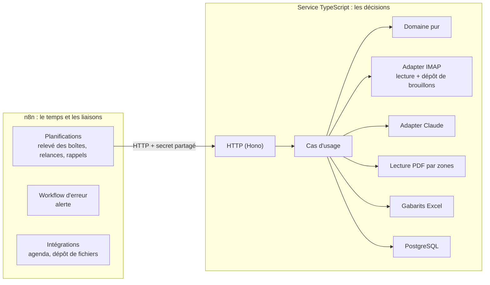

# relaisMetier — Feuille de route

Projet de démonstration, public : automatiser l'administratif d'une petite entreprise d'artisans **fictive** avec **n8n** comme chef d'orchestre et un **service TypeScript** qui porte les règles métier. Toutes les données sont synthétiques : aucun courriel, devis ni client réel n'entre dans ce dépôt.

Le projet réutilise deux dépôts publics existants :

- [mailHelper](https://github.com/GregoireChevalierACS/mailHelper) : domaine du courriel, règles de non-réponse, analyse par Claude encadrée par le domaine, contrat `BoiteDeReception` ;
- [FindAndFill](https://github.com/GregoireChevalierACS/FindAndFill) : lecture de sources (Excel, CSV) et remplissage déterministe de gabarits Excel, contrôle de structure.

Chaque phase a un critère vérifiable : elle est terminée quand il est rempli, pas avant. Les règles de développement sont dans [docs/bonnes-pratiques.md](docs/bonnes-pratiques.md).

## Le cas fictif

L'entreprise installe et entretient des équipements de chauffage. Elle compte quelques personnes et plusieurs boîtes mail partagées, sur un hébergeur IMAP standard. Son logiciel de devis produit des PDF et des exports Excel, mais n'a pas d'API. Son activité connaît des **pointes imprévisibles**, pendant lesquelles le dirigeant est en rendez-vous et l'administratif s'accumule.

| Besoin                                                                              | Phase |
| ----------------------------------------------------------------------------------- | ----- |
| Trier les courriels de plusieurs boîtes et préparer les réponses                    | 3     |
| Rédiger le mail qui accompagne chaque devis PDF                                     | 4     |
| Relancer les devis restés sans réponse                                              | 5     |
| Préparer les commandes fournisseurs et suivre les ruptures                          | 6     |
| Rappeler les contrats d'entretien annuels, suivre les devis dans un tableau de bord | 7     |

**Principe directeur : rien ne part sans validation humaine.** Le système dépose des **brouillons** dans la boîte de l'utilisateur, qui les relit et les envoie depuis son ordinateur ou son téléphone. Seules les relances peuvent, après une période d'essai, partir seules (phase 5).

## Architecture cible



Ce partage vient d'une contrainte : **n8n sait lire une boîte IMAP, mais pas y déposer de brouillon** (aucun nœud ne fait d'IMAP `APPEND`). Le service possède donc l'accès aux boîtes. n8n déclenche, planifie, réessaie et alerte, mais **ne décide rien** : aucun nœud Code ne porte de règle métier ([ADR 0001](docs/adr/0001-n8n-orchestre-le-service-decide.md), à écrire en phase 0).

```
relaisMetier/
  compose.yaml              n8n, PostgreSQL, service, serveur IMAP de test
  n8n/workflows/*.json      exportés par la CLI n8n et versionnés
  packages/domain           SequenceDeRelance, Devis, CommandeFournisseur, ContratDEntretien
  packages/application      cas d'usage, ports, schémas zod
  packages/jeu-synthetique  générateur de courriels, de devis PDF et d'exports Excel fictifs
  apps/service              adapters : HTTP, IMAP, Claude, PDF, Excel, PostgreSQL
  vendor/                   sous-modules mailHelper et FindAndFill
  docs/adr  docs/bonnes-pratiques.md
```

## Phase 0 — Socle

**Terminée quand** : `docker compose up` démarre n8n, PostgreSQL, le service et le serveur IMAP de test. Un workflow importé depuis `n8n/workflows/` appelle `GET /sante` et reçoit `200`. La CI passe avec les seuils de [docs/bonnes-pratiques.md](docs/bonnes-pratiques.md).

- [x] Monorepo pnpm, TypeScript strict, ESLint, Prettier, dependency-cruiser, Vitest, Stryker, commitlint, Husky.
- [x] `compose.yaml` : n8n (édition communautaire), PostgreSQL partagé (une base pour n8n, une pour le service), service et **GreenMail** comme serveur SMTP et IMAP de test. Mailpit ne convient pas : il ne fait pas d'IMAP.
- [x] Scripts `n8n:exporter` et `n8n:importer`, basés sur `n8n export:workflow --backup` et `import:workflow`. La CI vérifie que les JSON versionnés s'importent dans un n8n neuf (`pnpm smoke --arreter`).
- [x] Réutilisation de mailHelper et FindAndFill par **sous-modules Git** dans `vendor/`, inclus dans le workspace pnpm. Les dépôts sont publics : un clone suffit, sans jeton de registre.
- [x] Authentification entre n8n et le service par secret partagé, avec un service joignable seulement sur le réseau Docker interne.
- [x] ADR 0001 (n8n orchestre, le service décide), ADR 0002 (réutilisation par sous-modules), ADR 0003 (versions de l'outillage).

**Terminée le 2026-11-24** (PR #1) : pile démarrée, workflow importé dans un n8n neuf, `GET /sante` → 200, CI verte sur GitHub (vérification, smoke test, CodeQL, GitGuardian).

Défauts connus, non corrigés :

- Le domaine est vide : Stryker tourne avec `allowEmpty`, à retirer avec le premier concept métier (et à vérifier alors qu'un mutant non testé survit bien sous Vitest 5).
- Les workflows importés sont inactifs. Les workflows planifiés de la phase 3 devront être activés à l'import (`n8n publish:workflow` ou équivalent selon la version de n8n), et la CI devra le vérifier.

## Phase 1 — Jeu de données synthétique

**Terminée quand** : `pnpm generer:jeu --graine 42` produit, deux fois de suite, exactement les mêmes fichiers, et les attendus de chaque fichier (catégorie du courriel, champs du devis) sont générés avec lui.

- [x] Courriels fictifs, au format `.eml` : demandes de clients, questions récurrentes, réponses de fournisseurs (confirmation, rupture, délai), robots, lettres d'information, et quelques tentatives d'injection de consignes.
- [x] Devis PDF fictifs générés depuis un gabarit fixe (client, matériel, aides, montant), plus une **variante de mise en page** pour tester la détection d'un changement de format.
- [x] Exports Excel fictifs : devis signés, contrats d'entretien.
- [x] Chargement du jeu dans les boîtes GreenMail par une commande.

Inspiré de `packages/jeu-synthetique` de FindAndFill (aléa mulberry32, archives Excel aux octets figés, manifeste avec empreintes).

Ce que contient le jeu ([packages/jeu-synthetique](packages/jeu-synthetique/src/)), quelle que soit la graine :

| Fichiers                                                               | Contenu                                                                                                                                                                                                                               | Attendus dans `attendus.json`                                                                                                                                         |
| ---------------------------------------------------------------------- | ------------------------------------------------------------------------------------------------------------------------------------------------------------------------------------------------------------------------------------- | --------------------------------------------------------------------------------------------------------------------------------------------------------------------- |
| 50 courriels `.eml` dans 3 boîtes (`devis@`, `accueil@`, `commandes@`) | 12 demandes de devis (dont 2 avec `Reply-To`), 10 questions récurrentes, 4 reports de rendez-vous, 10 réponses de fournisseurs (4 confirmations, 3 ruptures, 3 reports), 5 robots, 5 lettres d'information, 4 injections de consignes | Catégorie, réponse attendue ou non, règle de mailHelper qui l'exclut, destinataire de la réponse, question posée, nature de la réponse fournisseur, consigne injectée |
| 8 devis PDF                                                            | Gabarit fixe : client, lignes, TVA, aides, reste à charge                                                                                                                                                                             | Tous les champs, en centimes                                                                                                                                          |
| 1 devis PDF en mise en page modifiée                                   | Blocs déplacés, ancres renommées (« Montant TTC » au lieu de « Total TTC »)                                                                                                                                                           | Refus `mise-en-page-inconnue`                                                                                                                                         |
| 2 exports Excel                                                        | 4 devis signés et leurs lignes par fournisseur ; 30 contrats d'entretien                                                                                                                                                              | Lignes attendues                                                                                                                                                      |

Choix de vérité terrain, à garder en tête pour l'évaluation de la phase 3 :

- une **rupture** fournisseur attend une réponse (remplacer l'article ou attendre), une confirmation ou un report non ;
- une **injection** est une vraie demande de client : elle attend une réponse au client, et jamais l'exécution de la consigne ;
- deux **pièges** par règle de mailHelper : une facture dont seul le `Reply-To` est un `noreply@`, et une lettre envoyée par une personne nommée que seul `List-Unsubscribe` trahit.

Toutes les adresses sont sous le domaine réservé `.test`, et les numéros de téléphone dans la tranche 01 99 00, réservée à la fiction.

**Terminée le 2026-11-24** (PR #6) : deux générations de la graine 42 sont identiques octet pour octet, et le chargement dans GreenMail donne 16, 24 et 10 courriels dans les trois boîtes, rejouable sans doublon. La CI le vérifie à chaque PR.

Défaut connu : les courriels envoyés (dossier « Envoyés », source des relances de la phase 5) ne sont pas encore générés. Ils viendront avec la phase 2, qui lira ce dossier.

## Phase 2 — Boîte IMAP (contribuée à mailHelper)

**Terminée quand** : `BoiteImap` passe le test de contrat `verifierLeContratDeLaBoiteDeReception` de mailHelper contre GreenMail en CI, et un brouillon déposé apparaît dans le dossier Brouillons avec sa pièce jointe.

- [ ] Adapter `BoiteImap` (imapflow) qui implémente `BoiteDeReception`, **dans mailHelper** : c'est du code générique.
- [ ] Nouveau port `DepositaireDeBrouillon` (IMAP `APPEND` dans le dossier des brouillons, avec le drapeau `\Draft`).
- [ ] Lecture du dossier « Envoyés », nécessaire aux relances.
- [ ] **Idempotence** : un courriel relu deux fois n'est traité qu'une fois. La clé est le couple `UIDVALIDITY` + `UID`, et le `Message-ID` sert de repli.
- [ ] Plusieurs boîtes, chacune avec ses identifiants et son parallélisme borné.

## Phase 3 — Tri et brouillons de réponse

**Terminée quand** : sur les 50 courriels d'évaluation du jeu synthétique, le tri donne la bonne décision « réponse attendue » dans au moins 90 % des cas. Aucun robot ni aucune lettre d'information ne reçoit de brouillon. Le temps et le coût d'un relevé de 30 courriels sont mesurés et notés ici.

- [ ] Workflow n8n `relever-les-boites` : toutes les 3 à 5 minutes, il appelle `POST /boites/:id/relever` pour chaque boîte.
- [ ] Chaîne de décision : règles déterministes de mailHelper d'abord, puis **Claude Haiku 5.5** pour le tri et **Claude Sonnet 5.5** pour la rédaction, seulement si une réponse est attendue.
- [ ] Base de réponses aux questions récurrentes (fichier Markdown versionné), placée dans un préfixe de consigne mis en cache.
- [ ] Jeu d'évaluation rejoué à chaque changement de consigne ou de modèle (`pnpm evaluer`), sans jamais toucher le modèle dans les tests unitaires.
- [ ] Workflow d'erreur n8n : une alerte par courriel à l'administrateur, au plus une par heure et par cause.

## Phase 4 — Mail d'accompagnement des devis

**Terminée quand** : chaque devis PDF du jeu synthétique, transféré à l'adresse dédiée, donne un brouillon complet avec le PDF joint, adressé au bon client. La variante de mise en page est **refusée avec un message clair**, et jamais lue de travers.

- [ ] Lecture des PDF texte par zones définies dans un modèle : c'est **la phase 5 de FindAndFill**, contribuée là-bas.
- [ ] Contrôle de structure : si les ancres attendues manquent, le devis est signalé au lieu d'être deviné.
- [ ] Rédaction par Claude à partir des **champs extraits**, jamais du PDF brut.
- [ ] Le destinataire vient du devis, pas du modèle de langage.

## Phase 5 — Relances des devis

**Terminée quand** : la machine à états `SequenceDeRelance` est couverte par des tests de propriétés. Une séquence s'arrête toujours dès la première réponse du client, et un même historique de courriels, quel que soit son ordre d'arrivée, donne les mêmes relances. Une semaine simulée de bout en bout produit les relances attendues à J+3, J+10 et J+21.

- [ ] Domaine : `SequenceDeRelance`, calculée à partir des faits (devis envoyé, réponse reçue, relance envoyée) et non mise à jour à la main.
- [ ] Le dossier « Envoyés » est la source : un mail avec un devis PDF joint ouvre une séquence.
- [ ] Fêtes, week-ends et absences déclarées décalent les relances.
- [ ] Deux modes : **brouillon** par défaut, et **envoi** par SMTP, activable par boîte, avec un interrupteur qui coupe tout.
- [ ] Concurrence optimiste en base : deux relevés simultanés ne créent jamais deux relances.

## Phase 6 — Commandes fournisseurs et suivi

**Terminée quand** : un devis signé qui touche deux fournisseurs donne deux bons de commande remplis par gabarit, en brouillon. Chaque réponse fournisseur du jeu synthétique est classée (confirmé, rupture, délai, autre) et met la commande à jour.

- [ ] Gabarits Excel par fournisseur, remplis par le moteur de FindAndFill.
- [ ] Classement des réponses par Haiku 5.5 en sortie structurée. Une réponse « autre » est laissée à l'humain.
- [ ] Relance automatique d'une commande sans nouvelles, selon les mêmes règles que la phase 5.

## Phase 7 — Rappels périodiques et tableau de bord

**Terminée quand** : l'export fictif des contrats d'entretien donne les rappels du mois suivant, sans doublon d'un mois à l'autre. Le tableau de bord hebdomadaire (devis envoyés, relancés, signés) se recalcule à la main à partir du jeu synthétique.

- [ ] Lecture de l'export Excel par `LecteurSources` (FindAndFill).
- [ ] Rappels annuels et confirmations de rendez-vous, en brouillon.
- [ ] Tableau de bord en Excel, rempli par gabarit et envoyé chaque lundi. Pas d'interface web à maintenir.

## Phase 8 — Tenue en pointe

**Terminée quand** : une semaine de pointe simulée (volume de courriels multiplié par 3) est traitée sans retard de plus de 15 minutes, et son coût d'API est mesuré et noté ici.

- [ ] Le service est branché comme système externe dans [batchTester](https://github.com/GregoireChevalierACS/batchTester) : les paramètres sont les volumes et la part des courriels qui demandent une rédaction, les mesures sont la durée et le coût.
- [ ] Balayage du parallélisme maximal, pour choisir la valeur par défaut.

## Phase 9 — Déploiement de démonstration

**Terminée quand** : une installation neuve sur un VPS se fait en suivant le README seul, en moins d'une heure. Une sauvegarde est **restaurée** avec succès sur une autre machine.

- [ ] Caddy en frontal (HTTPS) pour l'interface n8n seulement. Le service n'est jamais exposé.
- [ ] Sauvegarde quotidienne de PostgreSQL et des workflows, plus un essai de restauration documenté.
- [ ] Mise à jour de n8n et du service, avec retour arrière.

## Hors périmètre

- SMS, WhatsApp et réseaux sociaux.
- Pilotage de sites web sans API (RPA).
- Envoi automatique des réponses aux clients : seules les relances peuvent partir seules (phase 5).
- Mode « queue » de n8n et plusieurs workers : inutiles aux volumes d'une petite entreprise.

## Questions ouvertes

- Les brouillons déposés par IMAP `APPEND` apparaissent-ils dans les applications mobiles des principaux hébergeurs ? À vérifier dès la phase 2, avec repli : un courriel « à valider » envoyé à l'utilisateur.
- Licence de n8n : l'édition communautaire (_Sustainable Use License_) convient à une démonstration et à un usage interne. À relire avant tout usage commercial.

## Pièges rencontrés

| Symptôme                                                                                                                       | Cause                                                                                                                                                                                                        | Contournement                                                                                                                                                                                                      | Lien                                                                     |
| ------------------------------------------------------------------------------------------------------------------------------ | ------------------------------------------------------------------------------------------------------------------------------------------------------------------------------------------------------------ | ------------------------------------------------------------------------------------------------------------------------------------------------------------------------------------------------------------------ | ------------------------------------------------------------------------ |
| `docker compose build` échoue sous Windows : `additional privileges requested: pass "--allow=fs.read=apps\service\Dockerfile"` | Compose délègue à `buildx bake`, qui compare le chemin du contexte (`c:\…`, casse héritée de VS Code) à celui du Dockerfile (`C:\…`) : la différence de casse est vue comme une sortie du périmètre autorisé | Lancer Compose depuis `C:\…` ; les scripts `pnpm smoke`, `n8n:*` normalisent la lettre du lecteur                                                                                                                  | [scripts/docker-compose.mjs](scripts/docker-compose.mjs)                 |
| Stryker s'arrête : `No tests were executed`                                                                                    | Domaine encore vide en phase 0                                                                                                                                                                               | `allowEmpty: true`, à retirer au premier concept métier                                                                                                                                                            | [packages/domain/stryker.config.mjs](packages/domain/stryker.config.mjs) |
| Un workflow exporté contient l'identifiant du projet n8n, des dates et des numéros de version                                  | `export:workflow --backup` exporte aussi les champs propres à l'instance ; le projet n'existe pas dans un n8n neuf, et chaque export changerait le diff                                                      | `pnpm n8n:exporter` retire ces champs après l'export                                                                                                                                                               | [scripts/n8n-exporter.mjs](scripts/n8n-exporter.mjs)                     |
| dependency-cruiser refuse une règle : `has an unsafe regular expression`                                                       | Quantificateurs imbriqués (`(vendor/[^/]+/)?`), refusés par sa vérification anti-ReDoS                                                                                                                       | Une règle pour les paquets du dépôt, une autre pour les sous-modules                                                                                                                                               | [.dependency-cruiser.mjs](.dependency-cruiser.mjs)                       |
| GitGuardian signale 3 « Generic Password » dans `.env.example`                                                                 | Le marqueur `POSTGRES_PASSWORD=a-generer` ressemble à un mot de passe pour son détecteur générique                                                                                                           | Valeurs vides dans le modèle ; `pnpm env:creer` remplit chaque variable vide. Le détecteur analyse chaque commit de la PR : historique de la branche réécrit pour que le modèle vide figure dès son premier commit | [.env.example](.env.example)                                             |
| CodeQL (high) : _Potential file system race condition_                                                                         | `existsSync('.env')` puis `writeFileSync` : un `.env` apparu entre les deux serait écrasé                                                                                                                    | Écriture atomique avec le drapeau `wx`, qui échoue si le fichier existe                                                                                                                                            | [scripts/creer-env.mjs](scripts/creer-env.mjs)                           |
| Avertissement `unmet peer @vitest/coverage-v8@4.1.12` à l'installation                                                         | mailHelper est encore en Vitest 4, relaisMetier en Vitest 5 ; ses tests ne sont pas rejoués ici                                                                                                              | Aucun : sans effet. Disparaîtra quand mailHelper passera en Vitest 5                                                                                                                                               | [ADR 0002](docs/adr/0002-reutilisation-par-sous-modules.md)              |
